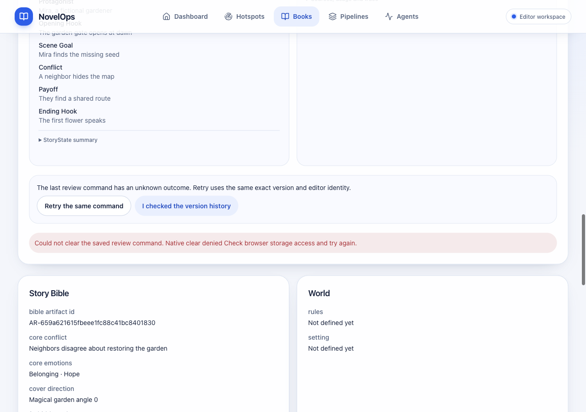
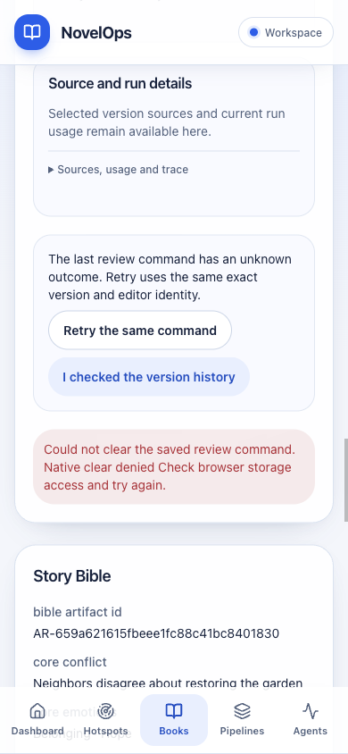

# 书籍与章节请求恢复验收 — 2026-10-11

## 结论与边界

本轮完成 ZEN-38/39/40/41 的存储读取、保存意图所有权及公开恢复修复，沿用每个 issue 的原 PR。验证了下面列出的恢复子需求事件；整个项目及各 issue 的全部验收仍未完成，未 merge、部署或改为 Done。

生产浏览器验收源码为 `62da7a1fd7bae74a5cd02dbb2c0d11c1368eb41f`，使用不可变 Next 生产构建、实际签名代理、FastAPI 与 Harness 内核。外部存储/模型提供者为合成测试设施，本轮没有调用真实 DeepSeek 或飞书 Base。视觉验收对应包含 ZEN-107 的完整依赖栈，不能证明设计改版之前祖先分支的视觉表现。

[完整结构化事实、请求响应、版本与失败记录](2026-10-11-book-storage-runtime.json)

## Issue → 行为 → 实现 → 验证 → 事件

| Issue / 原 PR | 需求行为与实现 | 回归与实际事件 | 本轮范围 |
| --- | --- | --- | --- |
| [ZEN-38](https://linear.app/zenhungyep/issue/ZEN-38) / [PR 32](https://github.com/autism-ip/novelops-agent-harness/pull/32) | 读取失败不能视为空请求；上下文前后与 POST 后检查保存字节；有效未确认请求可在检查 Books 后释放 | 新增 7 个原生边界回归。真实 POST 已提交、存储不可读时保留原请求；公开重查后重放相同原始请求。2 次 POST 返回同一 Book，独立 Books 查询只有 1 条；真实链接打开同一 canonical Book | 恢复及幂等子事件已验证 |
| [ZEN-39](https://linear.app/zenhungyep/issue/ZEN-39) / [PR 35](https://github.com/autism-ip/novelops-agent-harness/pull/35) | 规划上下文准备与提交不能覆盖另一保存意图；清理验证所有权，原生故障可见 | 新增 10 个真实组件/ApiClient 回归；实际受保护上下文与历史读取，桌面/手机公开控件保留有效或损坏字节，恢复后清理，0 POST | 新规划模型生成不属于此次运行时证明 |
| [ZEN-40](https://linear.app/zenhungyep/issue/ZEN-40) / [PR 36](https://github.com/autism-ip/novelops-agent-harness/pull/36) | 章节生成请求保持 Book/章节/版本/来源身份；不可读或变化时拒绝覆盖/删除 | 新增 10 个原生边界回归；真实生成上下文与历史，桌面/手机有效或损坏意图的清理故障与公开恢复，0 POST | 当前真实模型生成/定向重写仍待验证 |
| [ZEN-41](https://linear.app/zenhungyep/issue/ZEN-41) / [PR 37](https://github.com/autism-ip/novelops-agent-harness/pull/37) | 批准、拒绝、改写、锁定均先核对保存意图；成功 POST 不能删除并发保存的新命令 | 新增 14 个回归。手机真实批准 1 次，API 200、精确版本 approved、运行 completed；并发的新意图原字节保留，全部历史正文/Artifact/版本 ID 不变，公开清理/刷新不再提交 | 批准恢复已验证；真实模型改写与 final lock 全链路仍待验证 |

## 主要修改与决策

修改 `frontend/src/components/books/` 下 `book-bootstrap.tsx`、`story-planning.tsx`、`chapter-generation.tsx`、`chapter-review-desk.tsx`，同步 `frontend/CLAUDE.md`。

- 存储读取失败使用稳定的不可用标记，和不存在请求区分。SSR 仍不泄露会话内命令。
- 提交开始、异步上下文返回、成功 POST 清理前检查原始保存字节；不属于当前操作的意图保留，并显示恢复指引。
- 已检查历史后的清理也验证当前字节；原生 DOMException 原因可见，操作期间禁用清理。
- 保留原有精确请求重放、编辑者、版本和来源字段，没有调用禁用控件的私有回调。
- owner 分支修复后依次传播，设计合并保留触控尺寸和现代卡片样式。

## 测试、覆盖率与评审

每个修改分支独立执行 Node 24 下 `npm --prefix frontend run test:coverage` 和 `npm --prefix frontend run check`。后者包括零警告 lint、类型检查及生产构建，全部通过。

| 所属分支 / PR | 完整前端测试 |
| --- | ---: |
| ZEN-38 / 32 | 97 |
| ZEN-107 / 34 | 98 |
| ZEN-39 / 35 | 130 |
| ZEN-40 / 36 | 164 |
| ZEN-41 / 37 | 216 |

新增 41 个测试均先在修复前失败；真实组件和 ApiClient 保留，只有原生 fetch/Storage 边界受控。未删除、跳过测试或修改覆盖率配置，也未弱化精确命令、零写入和历史内容断言。

完整依赖栈覆盖率：

| 指标 | 覆盖 / 总数 | 覆盖率 |
| --- | ---: | ---: |
| Statement | 1000 / 1098 | 91.07% |
| Line | 868 / 929 | 93.43% |
| Function | 275 / 310 | 88.70% |
| Branch | 1123 / 1247 | 90.05% |

**要求的四项 100% 尚未达到。** 全量源码（含未导入文件）继续计入分母。CI 成功不能代替该要求或真实需求事件。

源码提交时的 13 个原 PR 均为最新 head CI SUCCESS，0 未解决行内线程；不是 Review 批准声明。完整评审/评论及 head 检查响应记录在 JSON。随后报告提交不改变应用源码，其新 head CI 另行核对。

依赖顺序仍为 23 → 24 → 25 → 27 → 28 → 29 → 30 → 31 → 32 → 34 → 35 → 36 → 37，每个 issue 使用原 PR。本轮 owner 实现：32 `3115646b`、34 `e246e4df`、35 `32bedaae`、36 `6d09aee8`、37 `62da7a1f`。

## 原生浏览器结果

沿用已授权空间 2/p1。桌面 1280×900、手机 390×844；实际 CSS 宽度匹配设备，无横向溢出；桌面详情为非模态，手机详情为真实模态。

规划/生成/评审 12 个有效或损坏请求恢复场景，以及书籍 4 个场景，均通过真实指针控件操作。存储故障期间没有业务 POST，原字节保留，控件高度至少 44px，0 未捕获异常。另有上述真实批准和幂等 Book POST/独立数据读取。

## 失败记录与处理

- 修复前书籍 7、规划 10、生成 10、评审 14 个新增回归失败，owner JSON 和本报告 JSON 保留测试摘要及失败列表。
- 生成测试先误用规划提示，再误写章节提示；最终精确断言源码原文，原字节/零 POST 断言不变。两次失败保留。
- 旧评审测试同时阻断全部读写却要求批准按钮可用。将其读故障限定到编辑者署名，保留原写入错误/零 POST 断言；新增测试单独覆盖请求读失败。随后未正确类型化的 spy 使类型门禁失败，改用原生 `Storage.prototype`，无类型断言或门禁放宽。
- 浏览器解除读取权限后，正常 React/历史刷新先恢复了尚未点击的重查控件。最终在原生公开重查点击的捕获阶段恢复对应测试键权限，未调用应用私有回调。两次定位失败及 0 POST、原字节事实保留。
- 诊断时一次 subtree snapshot 使用 CSS root，工具要求 snapshot ref；已有页面状态读取成功，没有业务变更。
- 真实批准已提交后，脚本按种子对象键顺序比较 JSON 字符串而失败。没有重新提交批准；改为核对完整字段，并再次独立读取实际批准状态、全部版本正文和 Artifact ID。保存的新意图仍按原始字节断言。
- 热点来源未在第一页，等待/点击失败；检查实际筛选和 canonical 来源后，通过公开状态筛选找到目标。
- 第一次关闭服务的自动审批超时、未执行；一次允许的重试完成清理，没有将超时误判为安全拒绝。

## 已知限制与后续工作

已验证事实限于上述恢复子需求。仍需完成全前后端四项 100% 覆盖率，以及当前真实 DeepSeek/飞书环境的完整生成、定向重写、选择性决策、最终锁定、语义质量/成本和部署权限/Schema/延迟/超时/轮询预算。

较早的手机首卡自动滚动被底部导航截获仍是一次工具恢复观察；本轮证明公开恢复控件、桌面来源点击和手机 Book 链接，不能推导全部手机指针旅程已验收。Book/state、Bible/brief、eligible brief 的空闲轮询需要在真实飞书延迟与读取成本下验证，当前合成 API 不能证明预算满足。

安全与资源边界：本轮无真实外部写入、无密钥复制/发布、无 profile 级清理；4 个本任务请求键都为空。Next 先退出 130，API graceful 退出 0，18431/18432 均无监听；构建副本在核对提交标记和依赖符号链接后移除。空间 2 留在空白页，保留给未完成的整体目标。

复用评估：沿用 issue-pr-delivery、TDD、Impeccable 既有视觉系统与 ego-browser。现有技能已经覆盖原生边界、公有控件、精确重放、owner 传播、失败审计与有限清理，本轮无需另建 Skill。
