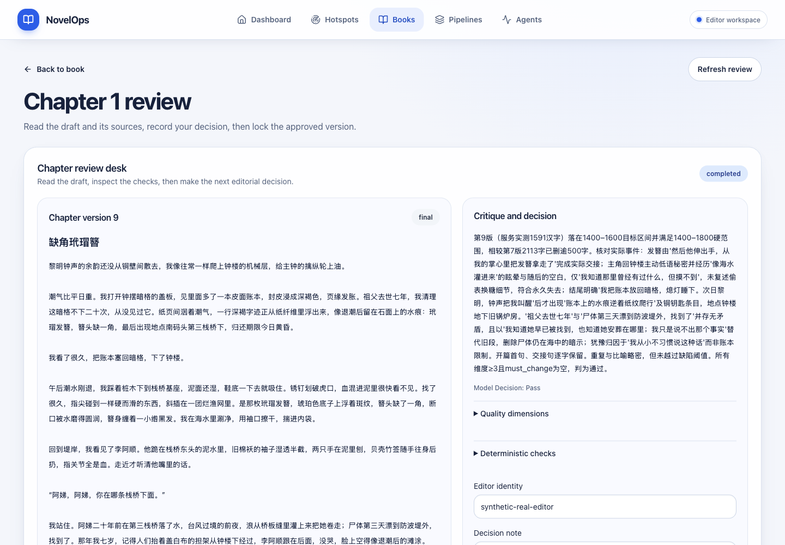
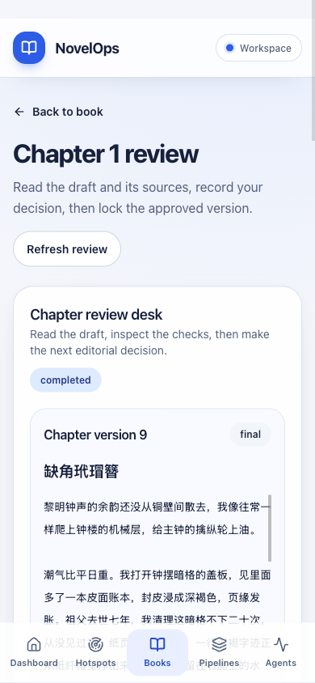

# 2026-10-18 合格章节真实定稿与独立审稿页

**全项目仍未完成。** 本报告确认一次真实需求事件：合格的第 9 版在真实 UI 中批准并 final-lock，飞书持久回读和停止后的完整快照一致。全部 13 个 issue、原 PR、剩余真实验收和全部适用覆盖率 100% 继续在范围内。此前 v6/v7/v8 的失败证据保留在[前次报告](2026-10-17-native-runtime-and-measured-critique.md)。

## 实际需求事件

[ZEN-41](https://linear.app/zenhungyep/issue/ZEN-41/build-chapter-review-desk-with-selective-approval-and-final-lock) / [原 PR #37](https://github.com/autism-ip/novelops-agent-harness/pull/37)；章节生成及正文度量所属 [ZEN-40 / #36](https://github.com/autism-ip/novelops-agent-harness/pull/36)。仍采用既有 13 层 PR 依赖，没有新建重复 PR，也未合并或部署。

- 授权[合成 Base](https://fcnaul7kb1kf.feishu.cn/base/T8I6buCMoaiLB6srVBrc9i2jnph)，真实 DeepSeek `deepseek-flash`。冻结后端源码 `0fb29c10412fa26be4fed3c8445490ed0feb60c9`；本次前端源码 `029ed3a26d1f4de633751e479d1c72d130bd1ad5`。不把前端新增页面归属于旧后端快照。
- Book `BK-612ff5ad0bfaaed202baf9fe0acf390f`，第 1 章第 9 版《缺角玳瑁簪》。Artifact `AR-0c61d88046756776efee02df8c35e1d2`；Version `CV-0c61d88046756776efee02df8c35e1d2`；原同一 Run `PR-a59c70f4418847e7959102df3dd71193`。
- 独立审阅确认实际归还、本人主动说出秘密、不可逆失去秘密事件及情感、熄灯睡下与次日黎明后铜钥匙条目；规范、指定原句、祖父七年与尸体已找到的事实一致。服务计数 **1591 汉字**，较 v7 的 2113 字减少 **522**，同时满足全部保留约束；不是只接受 Critic 的 pass。
- UI 精确批准一次，HTTP 200、约 **53.59 秒**；回读版本 approved、流程 completed。随后精确定稿一次，HTTP 200、约 **24.13 秒**；回读 `v9 · final`、三个决策按钮禁用、待重放命令为空。两步均无重试。
- 最终独立 API 回读约 **23.72 秒**：final、锁稿人 `synthetic-real-editor`、锁稿时间 `2026-10-17T17:18:05.596406+00:00`。九个不可变章节 Artifact 与批准前逐字段完全一致；只有 ChapterVersion 状态及锁定元数据改变，旧稿没有覆盖。
- 唯一源 v8 的 RevisionTask `RT-d6f0a10da7bedc7e2badc9998836ef08` 关联同一已完成 Run；其投影状态仍为 queued，此处不声称任务投影 completed。对应版本批准事件和执行关卡批准事件各一条，没有重复审批事件。
- 本次同一退修 Run 共 **2 次真实模型调用、0 供应商重试**；输入 20515、输出 2753 tokens，估算费用 0.0094581 美元。审批/锁稿没有新增模型调用。

## 交付实现与设计

独立地址 `/books/{bookId}/chapters/{chapterNo}/review` 校验路径及规范章节号 1–10000，复用现有真实审稿台与精确保存/重放命令机制。页面只读取当前章节 review API，不挂载全书及全部 Bible/Brief 历史，不启动生成；章节生成区新增 “Open review desk”，保留返回书籍和手动刷新。

按用户已选 Impeccable B 布局：桌面正文/历史与 Critic/决策分栏，手机单列；沿用珍珠白、深墨色、钴蓝、圆角卡片、44px 控件、原有短动效与减少动态效果偏好。使用真实内容，没有构造演示数据替代验收。

1440×1000 和 390×844 一轮检查：状态清晰、手机文档宽度 390，无横向溢出。是桌面浏览器视口模拟，不声称物理手机性能已测。

## 验证与覆盖率

| 范围 | 结果 |
| --- | --- |
| 前端 Node 24.19.0 | 25 个文件，254 项测试全部通过 |
| lint / typecheck / production build | 全部通过；新动态路由已构建 |
| 新独立路由与页面组件 | Statement / Line / Function / Branch 均 100% |
| **全前端** | Statement 1037/1118 = 92.75%；Line 899/945 = 95.13%；Function 293/320 = 91.56%；Branch 1169/1255 = 93.14% |
| **全后端既有验证** | 587 项离线通过；10 项可选真实集成未计入。Statement/Line 4087/4303 = 94.98%；Branch 966/1132 = 85.34%；原始 Function 410/422 = 97.16% |
| 后端来源 | 当前 `backend/` Git tree 与实测 `954f015cea14` 完全相同；本轮没有声称新跑后端测试 |
| Impeccable 机械检查 | 本轮变更目标 0 finding |
| 远端源码提交 CI | `029ed3a26d1f` 全部检查成功；13 个 PR 当前 review/inline/discussion 捕获见 JSON |

新增行为测试覆盖规范/非法路由、当前章节绑定、单一 review 读取、人工关卡不自动轮询、手动刷新、精确审批目标及持久回读、可发现入口随章节号改变且不发生成 POST。使用真实 hook、ApiClient 和审稿组件，只控制 HTTP 边界。没有修改覆盖率配置、忽略业务代码或放宽业务断言。

## 原生运行、性能与保留问题

完成定稿后有序停止原生后端，精确执行句柄退出 0，scheduler 不再运行；**346 条授权合成记录**完整快照，13 个集合，snapshot failures 为空。保留数据供人工检查，无清理/删除宣称。用户主目录、工作区未提交改动与密钥文件保持原样。

HTTP 存活期间曾确认调度器因 `FeishuAPIError` 停止。审批和定稿是同步 API，仍能完成；这不证明后台执行已恢复，也不把当前错误原因推断成限流、网络或代理。完整错误诊断与有界恢复仍待处理。

独立页首个审稿请求实测约 26.76 秒，后续回读约 20.26/21.85 秒；仍慢。减少全本读取 fanout 有行为证据，但没有隔离变量性能基准，不能声称全局耗时已解决。book 深链接会话失效后的登录入口、读取取消/退避与陈旧状态动作安全仍待修复。

## 人工审阅结论与后续

已验证事实：一次合格章节经真实 UI 批准、定稿，完整 provenance 与旧稿保护成立。工程判断：独立路由更适合单章连续审阅，复用同一审批逻辑减少分叉。未验证项：常规自动通过及其余章节、全部 issue 最终需求审计、剩余真实集成、全项目四项覆盖率 100%、调度器故障根因和登录恢复。

现有 13 个 PR 全部保留；未标任何 issue Done。合格单章、CI 绿色和新组件 100% 都不能替代整项目完成判定。复用 `issue-pr-delivery`、`ego-browser`、Impeccable optimize 与 React best-practices；此前精确命令与调度器恢复规则已沉淀并验证，无需新建重复 skill。
