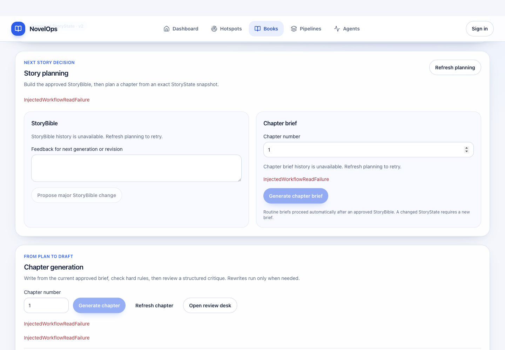
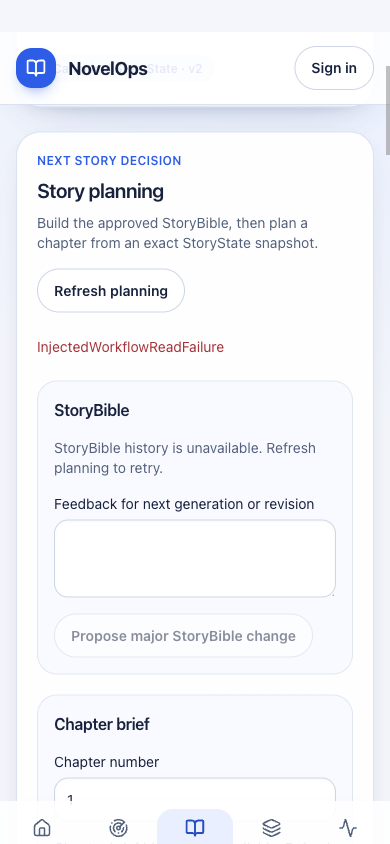

# 2026-10-18 规划/章节历史恢复与付费生成保护

**整项目仍未完成。** 接续[有界读取报告](2026-10-18-bounded-read-recovery.md)，修复其中两个面板把任意503误称“未配置”的问题。原真实章节定稿、登录恢复与读取预算证据保留。

## 原Issue、PR与源码

- [ZEN-39 / 原#35](https://github.com/autism-ip/novelops-agent-harness/pull/35)：`03771a6f48d3`，规划历史刷新、错误分类与生成保护。
- [ZEN-40 / 原#36](https://github.com/autism-ip/novelops-agent-harness/pull/36)：`f128a1f2041e`，章节运行历史、Brief资格错误及生成保护。
- [ZEN-41 / 原#37](https://github.com/autism-ip/novelops-agent-harness/pull/37)：`716c2e63f294`，合并后保留final-lock禁用、独立审稿入口及双方全部测试。

没有新建重复PR；所有修复在所属分支验证后同步后续依赖。后端应用树与真实定稿冻结源码 `0fb29c10412f` 一致，用户主工作区和环境文件未修改。

## 用户可观察行为

只有后端明确返回 `Story planning is not configured` 或 `Chapter loop is not configured` 的503才显示功能未配置。其他服务/存储错误保留恢复信息，历史不可读不显示假空列表、不误称没有批准Bible。

“Refresh planning”可从配置缺失或故障状态重读历史，不生成内容。运行历史或Brief尚未知/读取失败时，新生成按钮禁用；明确 `No current policy-eligible ChapterBrief` 的409才显示补齐提纲指引。其他Brief错误可见。待重放精确命令保持原样。

初始7项规划、9项章节回归复现旧问题。修改后的章节切换测试先断言历史读取中禁用，再等待就绪后提交，原精确来源/载荷断言保留。全书夹具改为真实409契约并补上现有review GET；新增无隐藏alert断言，没有把失败当空数据。

## 真实飞书读取 + 受控故障的浏览器验收

前端源码 `716c2e63`；后端源码 `0fb29c10412f`。先从真实授权飞书Base读取书籍和Canonical StoryState v2，再在工作流存储读取边界故意抛503。**这是只读负向UI验收：uvicorn lifespan明确关闭、调度器未启动，不冒充原生工作流再次验收或真实飞书故障。** 原生生成/审批/定稿的真实证据仍见[定稿报告](2026-10-18-chapter9-final-and-focused-review.md)。

同一空间4/p1确认：

- 书籍API200，规范状态与来源可读；工作流历史503。
- 三个入口 “Propose major StoryBible change”“Generate chapter brief”“Generate chapter” 均禁用。
- 没有“未配置”、假空历史或缺批准Bible的误导提示。
- 手动刷新规划一次，Bible/Brief两条读取进入新预算；截图结束时各由3次增为5次，包含新周期的一次自动重读，并非声称只发一次GET。
- 手机390px文档宽度390，无横向溢出。以下“InjectedWorkflowReadFailure”明确是注入的测试故障，不是实际平台错误。

探针已停止，441秒总生命周期；0模型尝试、0数据写入尝试、0HTTP写入。17个飞书操作为1次认证和16次只读search；POST search按操作语义归类为读取。没有把全部POST误算成数据修改。

## 当前外部定稿状态再次核验

另外直接只读查询当前飞书：9条ChapterVersion、9个Artifact、1个completed Run、2条批准事件、1个唯一退修任务均与停止时346条完整快照逐字段相同；9个Artifact内容哈希重新计算一致，第9版仍final、锁稿署名正确。无调度器、无模型调用、无写入。

第一次观察脚本误取不存在的`content_json`字段而停止；原失败保留。按真实存储契约`payload_json`纠正后完成全部核验，没有改数据、断言或生产代码。

## 测试、覆盖率和审查

| 原PR | 前端测试 | lint / type / build |
| --- | --- | --- |
| #35 | 204通过 / 17文件 | 全部通过 |
| #36 | 250通过 / 19文件 | 全部通过 |
| #37 | 321通过 / 26文件 | 全部通过 |

全前端：Statement **1104/1177=93.79%**，Line **955/993=96.17%**，Function **305/329=92.7%**，Branch **1278/1348=94.8%**，仍非100%。后端沿用相同树的587项离线验证；本轮不声称重跑后端。没有更改覆盖率配置、ignore或降低业务断言。Impeccable机械检查0 finding；桌面/手机一轮检查，无样式重做。

捕获时13个原PR对应源码head全部CI成功、0 unresolved；报告新提交仍须按新head核验。当前Linear原13项In Review，旧5项Done，未改状态；GitHub18个issue，13open/5closed，无新增。

## 原始范围与下一步

已重新读取13个当前Linear issue的完整目标、范围和验收。ZEN-40原文是前1–3个**章节版本**，没有要求必须额外生成3个不同章节；此前报告“其余章节”的待办来自推断。本次保留完整原始版本、来源、质量和选择性审批要求，继续逐条建立实际证据矩阵，自动通过策略仍需明确审计。

已验证事实：上述错误恢复、付费生成保护、真实规范数据读取及当前定稿完整性。工程判断：明确区分配置错误和不可读状态可避免重复付费或误改配置。未完成：全项目适用覆盖率100%、13个issue最终需求审计、必要真实集成、长运行调度器错误的可核验诊断、当前新head CI/review。另发现Dashboard只展示HTTP活性，Pipelines/Agents仍为静态空列表，需核对执行就绪展示与真实运行状态。

继续复用现有交付、TDD、安全、Impeccable和浏览器skill；局部历史门禁属于应用实现，无需重复建skill。未合并PR、部署或标Done。
