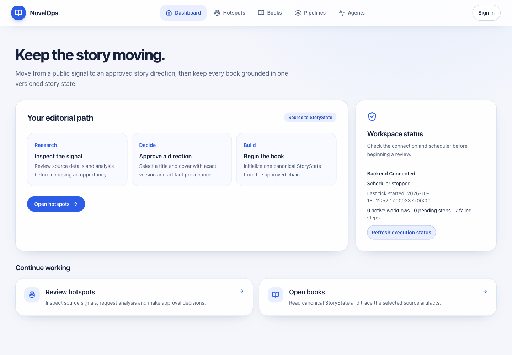
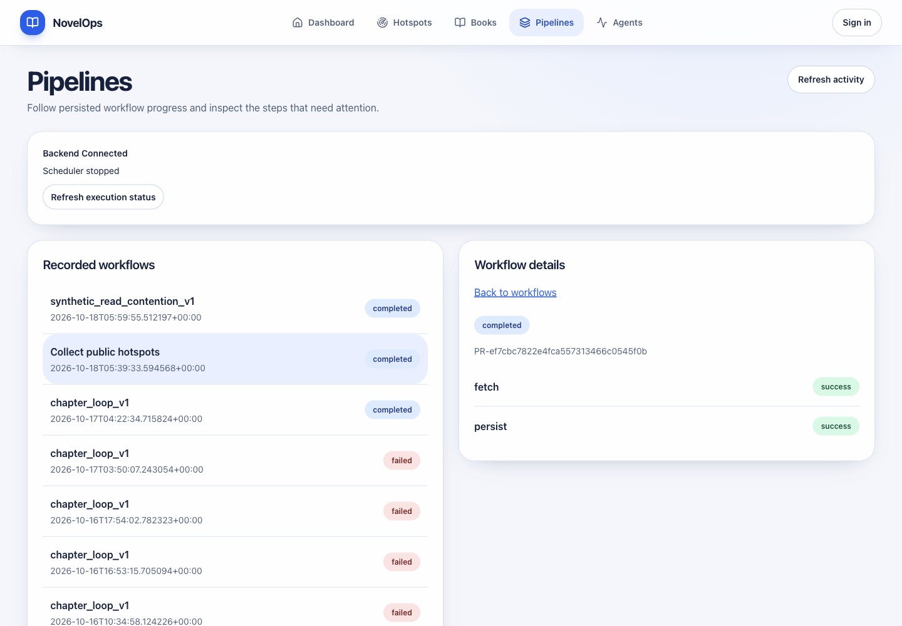
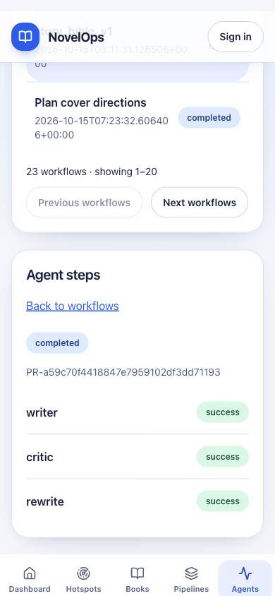

# 2026-10-18 真实工作流观察与执行状态

**本轮真实用户可观察事件已发生；整项目仍未完成。** 所属原交付 [ZEN-107 / PR #34](https://github.com/autism-ip/novelops-agent-harness/pull/34)，顺序同步至原#35、#36、#37，没有新增重复PR。

## 问题与实现

Pipelines/Agents原先把空数组渲染为“No pipelines yet”/“No agents running”，不能代表真实Base中已存在的流程。Dashboard只检查HTTP活性，不能说明调度器还在执行。

- `workflow-monitor.tsx`通过既有保护GET读取真实WorkflowRun；只在选中后读取该流程步骤，不逐个预取全部详情、不创建业务任务。20条本地分页，加载/失败/401可见，手动刷新重启既有读取预算。
- Agents按所选步骤的`kind=agent`展示，未知步骤/分类明确提示不完整，仅真实读到非agent步骤时才显示该流程无agent步骤。没有新建独立AgentState、记忆或全局虚假零计数。agent步骤数不是模型请求数。
- `health-indicator.tsx`从现有SystemStatus分别显示backend、scheduler、最后tick和已观察计数。HTTP仍通而worker停止时，明确显示Scheduler stopped。
- 保留已选Impeccable B构图：桌面列表/详情分栏、既有圆角Surface/色彩/按钮动效，窄屏单列，选中后焦点进入详情，返回链接恢复列表位置。异步内容到达后只在超出可见范围时定位一次，刷新/轮询不反复抢位置；遵循减少动态效果设置。

没有新增模型、运行调度器控制、数据写入或新的后端接口。原版编排、保存请求、审批和定稿功能继续由各所属PR交付。

## 确切源码与原生验收

前端初始实现`f8aef63`，定位修正`d93a71e`。后端使用完整冻结源码`9dbc38d4b5066c560927f6f4c70786d0733016a5`，单一原生lifespan调度器、真实飞书应用身份；业务写入、公开采集和模型provider均禁止。不是用mock数据替代真实状态。

在同一授权空间4/p1验证：真实流程共23条，末页3条且Next禁用；公开采集流程的fetch/persist均success，点选焦点正确。原有章节退修流程可读到writer、critic、rewrite三个真实agent步骤，逐项与持久化停止快照相符。本轮读取没有执行这些步骤或产生模型请求。

随后实际停止该调度器但继续保留HTTP服务，Dashboard刷新同时显示Backend Connected与Scheduler stopped，没有把HTTP成功当执行就绪。该停止由验收主动发起，不冒称复现了此前长期运行的飞书故障。原生服务最终正常退出0，403条记录在前后逐字段相同，业务写入尝试0、HTTP修改0、模型provider未创建。之前50条公开热点及所有章节版本仍保留，详见[公开入库报告](2026-10-18-public-hotspots-real-feishu.md)。

## 手机修正及最终观察

第一轮手机数据与焦点正确，但异步详情展开后卡片从606px开始，部分步骤落到视口下方。新增回归先失败，再补一次到位后的可见性定位；桌面已可见面板不滚动，返回列表优先于晚到数据。

最终截图和定位补验使用相同真实飞书数据、明确关闭lifespan的只读HTTP；**这是UI修正确认，不是再次声称原生工作流执行验收。** 后端接口与原生验收相同冻结源码，前端为`d93a71e`。

390px视口与文档宽度均390；实际详情范围332.24–740.24px，三个步骤完整可见，无横向溢出。正常平滑滚动完成后，两次成功轮询scrollY均2349.5；返回列表后的样本341/340.5，差0.5px，焦点为recorded-workflows，无alert。减少动态效果模式另测得动画/过渡均`1e-05s`。

早前一次联合稳定性断言未保存前后数值，不能倒推出唯一原因；现场为平滑滚动且关闭前API均200。另一观察在辅助服务到达10分钟上限后遇到503，前端正确显示未知/服务不可用，没有假空。原记录、截图和后来终止前端产生的错误分开保留。最终用同一有界编排器确认服务存活、等待实际滚动目标、先存每次样本再断言，观察与服务均退出0。稳定性补采沿用同一d93a71e生产构建，没有重跑业务任务。

首次selector错误把三条真实步骤当成单元素等待；改为first-child后继续同一个已选流程，没有再次点选任务。初次依赖链接超出Turbopack根目录、后续构建端口错误也均保留；改用同锁文件本地依赖、允许本地构建端口并只清理该隔离树失败生成的.next后，原有生产门禁通过，没有修改构建配置。

## 测试与覆盖率

| 原PR | 测试 | Statement | Line | Function | Branch | lint/type/build |
| --- | --- | --- | --- | --- | --- | --- |
| #34 | 176通过 | 92.02% | 93.71% | 88.42% | 89.77% | 通过 |
| #35 | 226通过 | 93.13% | 95.08% | 90.98% | 92.19% | 通过 |
| #36 | 272通过 | 93.41% | 95.58% | 91.95% | 92.71% | 通过 |
| #37 | 343通过 | 94.69% | 97.14% | 94.69% | 95.11% | 通过 |

初始15项页面契约先红；分页回归1项先红；异步定位1项先红。新增22项围绕真实读取、缺失/空历史、分类、401、存储故障恢复、分页、失败步骤、焦点与返回、HTTP/worker分离；原健康测试保留连通、失败及离开后的取消断言，并升级到SystemStatus契约。未删测试、改ignore或降低门槛。

新流程监视组件及更新状态组件的Statement/Line/Function/Branch均100%。完整前端仍未达到100%，具体分支指标见相邻JSON；后端app树与此前592项离线验证及原生实测一致，本轮UI改动未重复声称重跑后端。Impeccable机械检查0 finding；React检查涵盖并行独立读取、按需详情、取消、稳定key及焦点。没有新增依赖。

## 判断、限制与后续

已验证：真实历史不再显示假空；agent执行来自流程事实；HTTP与实际worker停止可区分；手机完整阅读及返回/轮询位置稳定；原403条记录不变，本轮无付费调用。工程判断：选择性读取与未知状态提示降低误判与重复操作风险。

底层workflow列表仍一次返回全部记录，20条仅为浏览器分页，不声称已实现服务端分页或大规模历史吞吐。详情是非事务进度观察，网络故障按现有预算暂停后由刷新恢复。长期调度器故障的原始原因仍未确立；新状态展示不替代根因修复。整项目还需原13项最终需求矩阵、其余必要真实集成及全部适用覆盖率100%。新推送head的CI/review另行复核，不据旧绿色检查标Done。

按skill-creator窄幅完善现有个人issue-pr-delivery：在断言/清理前保存观测值，等待初次过渡的可观察稳定状态，并核实有界服务生命周期。格式校验通过，实际受控补验覆盖正向与失败场景；没有声称独立子代理验证，也没有新增skill体系或扩大授权。

未合并、部署或修改Issue完成状态。当前报告和截图只包含流程元数据与验证结果，不包含公开热点正文、逐行JSON或凭据。
