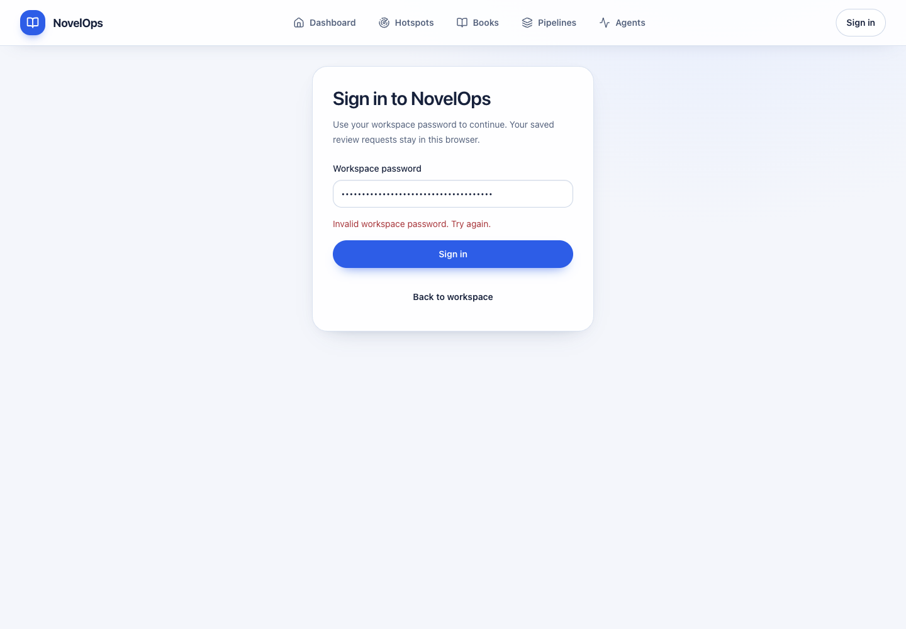
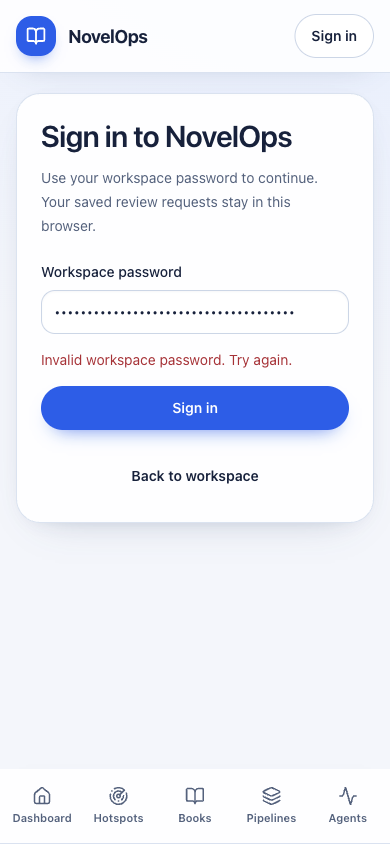

# 2026-10-18 全局登录与书籍深链接恢复

**整项目保持未完成。** 本报告接续[真实章节定稿](2026-10-18-chapter9-final-and-focused-review.md)，修复其中已确认的登录恢复缺口。实际内容定稿证据仍来自前次真实 DeepSeek + 飞书运行，不把本轮身份验证当成内容流程再次验收。

## Issue 与交付

[ZEN-107 / 原 PR #34](https://github.com/autism-ip/novelops-agent-harness/pull/34)，所属源码 `a17817c8`；按依赖同步原 PR #35 `7fbd188c`、#36 `4554e816`、#37 `dfbdb922`，无重复 PR。每个分支分别完成前端覆盖率与 lint/type/build 后推送；后端树没有改变。

## 实际用户行为

全局导航提供 “Sign in”，从书籍或章节深链接进入 `/sign-in?returnTo=...`；登录成功返回同一页面。沿用既有服务端密码校验、24小时签名 HttpOnly/Secure/SameSite=Lax cookie。新表单不存密码、不把密码加入 URL，也不清除保存的精确审稿/生成命令。

返回地址只允许已知工作区路径、规范 Book ID 和有效章节号；外部地址、双斜杠、反斜杠、javascript、API 路径、遍历、查询、fragment、非字符串和非法章节号均回退 `/books`。密码错误或连接故障可修正重试；保存中锁定提交，防止重复。

## 真实浏览器验收

使用同一空间4/p1，完整前端源码 `dfbdb922`。通过独立临时签名配置使原 cookie 失效，没有修改用户环境文件或清理其他站点会话。

1. 原章节深链接的受保护 API 返回401，明确提示登录，全局入口保留精确章节地址。
2. 错误测试密码返回401，显示 “Invalid workspace password. Try again.”；页面保留输入和返回目标。
3. 本机已配置密码仅在节点内部读取后填入真实 password 字段，登录返回200，原章节 URL 成功恢复。共两次登录提交，其中成功一次，没有重复成功请求。
4. 仅记录 cookie 属性：HttpOnly、Secure、SameSite=Lax、path=/；没有打印或提交 cookie 值。返回后 password 输入已不存在。
5. 此时真实内容后端按前次验收已有序停止。受保护请求已通过认证后遇到连接拒绝，当前代理返回500，**没有声称章节内容本轮加载成功**。该观察同时暴露持续每5秒重读错误及代理传输错误缺少明确恢复信息；下一步修复，不把500算成业务验收成功。

观察脚本在成功返回后曾因不支持的 role 定位语法、随后匹配到框架 announcer 而停止；改用当前页面只读、按审稿区域范围提取后完成记录，没有再次提交登录。完整结果、状态及耗时见 JSON。

1440×1000 与390×844 一轮检查，表单及44px控件可用、手机文档宽度390，无横向溢出；沿用已确认的 Impeccable B 视觉系统。没有新增装饰性动效或虚构数据。

## 测试与覆盖率

| 所属原PR | 前端测试 | 门禁 |
| --- | --- | --- |
| #34 | 137通过 / 14文件 | lint、类型、生产构建通过 |
| #35 | 179通过 / 17文件 | 同上 |
| #36 | 216通过 / 19文件 | 同上 |
| #37 | 287通过 / 26文件 | 同上 |

33项新增测试围绕安全返回地址、空密码、重复提交、真实 ApiClient 登录协议、错误恢复及原业务命令保护。新路由、表单和安全返回函数的 Statement/Line/Function/Branch 均100%。同步时书籍回归仍期待旧的“热点登录”文案，已更新到本次要求的工作区文案，保留错误必须可见、不可当空书库的断言。

全前端：Statement **1078/1151=93.65%**，Line **932/970=96.08%**，Function **300/324=92.59%**，Branch **1208/1276=94.67%**。全后端上次587项测试仍是相同树，未声称本轮重跑。全项目100%尚未达到，无覆盖率配置变更、忽略或业务断言放宽。机械 Impeccable 检查0 finding；最终远端CI需按对应head核验。

## 事实、判断与未完成事项

已验证：失效会话能找到入口、纠正密码、建立安全cookie并返回原章节；单位测试保护非空待重放命令。工程判断：全局入口和单一站内返回策略适合书籍/章节连续操作。未验证/未解决：本轮没有重启真实内容后端；代理离线响应、读请求退避与取消、调度器故障根因、常规自动通过、其余章节、全13个issue最终审计和全项目覆盖率仍待完成。

复用 issue-pr-delivery、ego-browser、Impeccable harden、security-review 与 TDD；不为单一登录表单创建重复skill。原PR仍In Review，未合并、部署或标Done。
